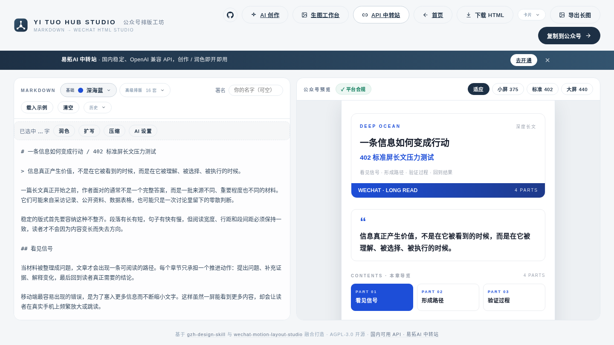
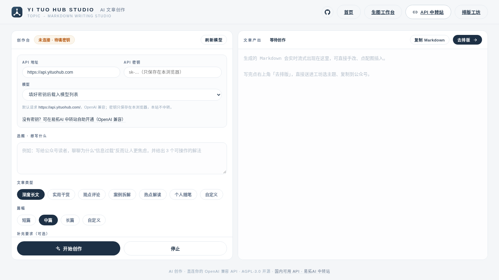

> 🤝 **本项目由 [颜](https://github.com/yan9651688) × 蓝梦（[lanmengSakura](https://github.com/lanmengSakura)）联合打造** —— 排版引擎与产品体验来自颜，原创视觉与动效组件库来自蓝梦的 wechat-motion-layout-studio。

<div align="center">

# YI TUO HUB STUDIO · 公众号排版工坊

**把 Markdown 一键排成可直接粘贴进微信公众号编辑器的精致 HTML**

16 套基础排版 · 4 套创意高级排版 · 81 种分级组合 · 79 组动静态组件 · 一键复制

[](LICENSE)
[](#-两个主题库18--16)
[](#-高级排版分级视觉)
[](#-快速开始)
[](#-作者)

</div>

---

**姊妹项目**：[NEON ARCADE · AI 小游戏站](https://game.yituohub.com/) —— 25 款 AI 参与创造的网页小游戏，免费在线玩，点开即玩。

---


打开网页，粘贴 Markdown，选一套主题，点「复制到公众号」——粘贴进编辑器，**样式纹丝不丢**。每段自动标关键词下划线、章节自动编号配英文小标、引言卡与导读目录自动生成、文末签名自动合并、中英标点自动全角化，并在你点击复制前用合规校验器把公众号编辑器的所有红线兜一遍。

## ❤️ 赞助商

> 想出现在这里？欢迎通过 [Issue](https://github.com/yan9651688/yituo-hub-studio/issues) 联系我们。

<details open>
<summary>点击折叠</summary>

[](https://www.yituohub.si/)

感谢 **易拓 AI** 赞助本项目！易拓 AI 提供安全、稳定、透明的 GPT、Claude 等 AI 模型 API 服务（OpenAI 兼容），支持 Codex、Claude Code / Claude 桌面版、DeepSeek 桌面版等客户端**一键配置**——运行配置命令即可自动填入密钥，无需手动粘贴，按量计费、用多少付多少；站内还提供 Skills / MCP 推荐、模型广场，以及基于 GPT Image 2 的文生图与改图。本项目的「AI 文章创作」「AI 润色」默认对接的 OpenAI 兼容 API 即可在易拓 AI 开通：👉 [www.yituohub.si](https://www.yituohub.si/)

</details>

## 🌐 在线体验

- **<https://studio.yituohub.com>** —— 打开首页，点「开始排版」即可
- **<https://studio.yituohub.com/create.html>** —— AI 文章创作：填入自己的 API 密钥，从选题直接写到可排版的文章
- **<https://studio.yituohub.com/gen/>** —— 生图工作台：注册并绑定自己的 Yi Tuo Hub 密钥，gpt-image-2 系列模型文生图 / 参考图改图

## ✨ 核心特性

- **AI 文章创作**：填入你自己的 OpenAI 兼容 API（默认 `https://api.yituohub.com/`），模型列表自动拉取；六种文章类型 + 自定义 prompt、三档篇幅 + 自定义字数，流式生成公众号文章 Markdown，一键送进排版工坊。
- **配图零门槛**：Ctrl+V 粘贴截图 / 拖入 / 选文件，自动压缩转 base64 内联进文章，不依赖图床；也支持自建图床（兰空 / EasyImage / sm.ms 风格）自动上传换外链，上传失败自动回退 base64。
- **生图工作台**：顶栏一键直达 `studio.yituohub.com/gen/`，注册绑定自己的 Yi Tuo Hub 密钥，用 gpt-image-2 系列模型文生图、参考图改图，文章封面与配图直接出图。
- **两个并列主题库（2026.11 调整）**：原 16 套高级排版（蓝梦原创视觉）转为「基础排版」；「高级排版」改为 4 套新创意排版——水墨长卷 · 复古号外 · 像素游戏机 · 胶片影志，纯静态内联结构，兼容性优先。旧 18 套基础主题已下线，备份于分支 `backup/before-theme-restructure-20261104`。
- **六档高级排版**：“高级排版”库提供 L1 黑白极简单例，以及 16 套主题各自的 L2–L6；静态简约、静态标题栏、静态主题场景、标题动效和完整主题动效都在原 Studio 内切换。
- **动态 / 静态成对**：L5、L6 可直接切换为几何一致的静态回退；正文、章节文字始终保持普通可编辑 HTML。
- **终稿结构不重造**：L4–L6 直接以冻结的 V24 静态终稿和其 V6 动态派生模板为结构源；标题、导读框、目录、章节装饰与尾部 `content_anchor` 原样保留，只替换 Markdown 文本槽。
- **不掉格式**：样式全部内联、文字一律 `<span leaf="">` 包裹；基础主题继续规避脆弱布局，高级排版仅保留终稿透明叠层所必需的 `display:grid`，不使用 absolute/fixed/sticky 定位。
- **智能排版**：每段第一个 `**加粗**` 自动升级为主题色关键词下划线；`==荧光笔==`、`++下划线++` 扩展语法；章节自动编号（01/02…）+ 英文小标（实战→PRACTICE、总结→SUMMARY）。
- **杂志级封面**：`# 标题 / 副标题` 一行生成编辑部风杂志卡——刊头小字、双色大标题、关键词行、彩色底栏。
- **按需内联资产**：只加载当前主题所需的 Production V6 组件或最终模板；复制结果仍是没有本地路径依赖的自包含正文。
- **双关卡质量校验**：产物实时过平台红线检查（禁用标签/属性、`span leaf` 覆盖率、中英混排半角标点提醒），ERROR 清零才建议交付。
- **一键复制 / 下载 / 导出长图**：富文本直接进剪贴板，公众号编辑器 ⌘V 即达；可下载 .html 兜底，也可用仓库内置的离线 `html2canvas` 将当前预览以 3× 清晰度导出为 PNG 长图。外链图片需支持 CORS，超长文章会按浏览器画布上限自动降低导出倍率。
- **零构建零后端**：纯静态文件，无依赖无框架，任何一台 nginx 都能跑。
- **草稿与排版历史**：编辑内容与主题配置自动存草稿（IndexedDB，本机保存），刷新不丢；「历史」记录最近 20 次复制/下载的排版，一键恢复 Markdown + 主题组合。
- **富文本粘贴**：从网页 / 飞书 / Notion / Word / 公众号复制的文章直接粘进编辑器，自动转换为 Markdown（含 ==高亮==、++下划线++ 扩展语法）；剪贴板已是 Markdown 时保持原样。
- **封面图 / 分享卡导出**：一键导出当前主题的公众号封面 PNG（900×383，2 倍清晰度）与朋友圈分享竖卡（1080×1440），分享卡可嵌入本地二维码图片。
- **自定义配色**：每套高级排版主题在 4 套定制配色之外，可调出自己的底色 / 强调色（实时对比度提示，本地保存）。
- **易拓 AI 中转站入口**：首页 / 工坊 / 创作页顶栏与推广条直达 [易拓 AI](https://www.yituohub.si/)，没有 API 密钥时可在那里开通（仅为链接，不影响排版功能）。
- **AI 润色**：编辑器选中一段文字，直接润色 / 扩写 / 压缩，流式替换回原文；设置与 AI 创作页共享。

## 🤖 AI 文章创作

打开 <https://studio.yituohub.com/create.html>（或首页「先 AI 写一篇」），填入你自己的 API 密钥即可开始创作：

- **自带 API 才能创作**：默认请求 `https://api.yituohub.com/`（OpenAI 兼容），地址可改；模型列表从 `/v1/models` 自动拉取。密钥只存在你浏览器 localStorage，浏览器直连你填写的 API，本站不中转、不落地。
- **类型与篇幅**：深度长文 / 实用干货 / 观点评论 / 案例拆解 / 热点解读 / 个人随笔 六种内置类型，也支持「自定义」类型 prompt；篇幅三档之外可填任意字数（如「约 2200 字」）。
- **流式生成 + 续写**：边生成边看字数，可随时停止；「追加模式」在已有文章后继续写。
- **配图两条路**：粘贴/拖入的截图自动压到最长边 1600px 后转 base64 内联（无需图床）；配置图床后自动上传换外链（兼容兰空 / EasyImage / sm.ms 风格的返回格式，密钥发送方式可选），失败自动回退 base64。
- **一键去排版**：生成完点「去排版」，文章直接进工坊编辑器，选主题、复制到公众号，生成内容已按本站语法调教（章节自动编号、段首加粗变关键词下划线、`==荧光高亮==` 等）。

## 🖼 生图工作台

首页 / 工坊 / 创作页顶栏的「生图工作台」直达 <https://studio.yituohub.com/gen/>，补齐「生图 → 写作 → 排版」链路的第一环：

- **自带密钥生图**：注册后在「设置」绑定自己的 Yi Tuo Hub 密钥（服务端存储、前端脱敏展示），费用直连你的账户，本站不经手。
- **三模型**：gpt-image-2 / gpt-image-2.5-flare / gpt-image-2.5-sunburst，文生图 + 参考图改图（最多 4 张）。
- **资产页**：生成图集中管理、一键下载，每张带剩余保留天数角标。
- **日志页**：最近 100 条生成记录（模型、耗时、成败与失败原因可见）。
- **7 天保留**：图片与记录到期自动清理，页面多处明确告知，重要图片请及时下载。
- **体验细节**：四步进度动画、结果区持久化（切走再回仍在）、图片点击全屏放大、明暗双主题。

> 生图工作台是独立部署的服务（源码见 [yituo-img-studio](https://github.com/yan9651688/yituo-img-studio)），线上经 `/gen/` 子路径与主站同域集成，**不在本仓库内**——本地快速开始起的静态站没有这个入口，部署与二次开发请看它的 README。

## 👀 产品预览

<table>
<tr>
<td width="50%" align="center"><br><sub><b>电影感首页 · 照片级雪山 + 云雾漂移 + 鼠标视差</b></sub></td>
<td width="50%" align="center"><br><sub><b>高级排版 · 素金手记（黑金刊读）L4 静态终稿，16 套高级排版之一</b></sub></td>
</tr>
<tr>
<td width="50%" align="center"><br><sub><b>排版工坊 · 左侧 Markdown，右侧公众号实时预览 + 平台合规校验</b></sub></td>
<td width="50%" align="center"><br><sub><b>AI 文章创作 · 自填 OpenAI 兼容 API，流式生成后一键去排版</b></sub></td>
</tr>
</table>

## 🎨 两个主题库（18 + 16）

| 分组 | 主题 |
|------|------|
| **杂志编辑部**（原创 6 套） | 深海蓝 `#1D4ED8` · 曙光橙 `#EA580C` · 星穹紫 `#7C3AED` · 鎏金黑 `#111827` · 青瓷 `#0F766E` · 绯樱 `#DB2777` |
| **经典复刻**（致敬 [gzh-design-skill](https://github.com/isjiamu/gzh-design-skill)） | 摸鱼绿 · 红白风 · 石墨极简 · 留白禅意 · 摸鱼票据 · 橄榄手记 |
| **新锐系列** | 摩卡 · 勃艮第 · 午夜靛蓝 · 芒果琥珀 · 湖水青 · 燕麦拿铁 |
| **高级排版**（蓝梦原创视觉，来自 [wechat-motion-layout-studio](https://github.com/lanmengSakura/wechat-motion-layout-studio)，16 套） | 墨红社论 · 黑金刊读 · 松烟刊读 · 珊瑚杂志 · 瑞士信号 · 柑橘报告 · 蓝图网格 · 稻纸朱砂 · 植物手记 · 柔和陶土 · 深海终端 · 雾蓝研究 · 紫灰工作室 · 新粗野 · 暗夜编辑 · 档案棕褐 |

> 基础主题仍由 `themes.js` 的参数化 spec 管理；“高级排版”使用蓝梦原创的独立注册表与 Production V6 组件，避免和基础换色模板混为一类。其中「松烟刊读」为项目内自「黑金刊读」派生的姊妹篇。

## ✨ 高级排版分级视觉

完整矩阵为 **1 个黑白极简单例 + 16 套主题 × 5 个主题等级 = 81 种组合**：

| 等级 | 输出 |
|------|------|
| L1 黑白极简 | 唯一单例，无主题色、SVG 与动效 |
| L2 静态简约 | 16 套定稿静态结构 |
| L3 静态装饰标题栏 | 静态标题引导线 + 章节路径装饰 |
| L4 静态主题场景 | 冻结 V24 完整静态模板，含标题、导读、目录、章节与尾部锚点 |
| L5 标题场景动效 | V6 动态标题 + V24 其余静态终稿结构 |
| L6 完整主题动效 | 由 V24 静态终稿派生的完整 V6 动态模板 |

L5、L6 右侧会出现「动态 / 静态回退」切换。两份输出使用同一组 viewBox 与锚点几何；自动测试同时锁定 30 份最终模板哈希及尾部 `content_anchor`。浏览器通过只能证明本地结构正确；正式发布前仍需在目标公众号编辑器中完成粘贴、保存、重开与真机预览。

## ✅ 适合 / ❌ 不适合

**✅ 适合**：教程 · 测评 · 观点长文 · 知识清单 · 数据复盘 · 生活随笔 · 品牌专栏 —— 凡是要发公众号的 Markdown / 纯文本，选主题一键排成合规 HTML。

**❌ 不适合**：普通网页 / 落地页 · PPT · 纯图片海报 · **代写文章**（本工具只排版、不写作——先有稿子再用它）。

## 🚀 快速开始

```bash
git clone https://github.com/yan9651688/yituo-hub-studio.git
cd yituo-hub-studio
python3 -m http.server 8123
# 打开 http://localhost:8123 —— 首页
# 打开 http://localhost:8123/studio.html —— 排版工坊
# 打开 http://localhost:8123/create.html —— AI 文章创作
# 生图工作台（studio.yituohub.com/gen/）为独立部署的服务，不在本仓库内，见「🖼 生图工作台」一节
```

运行开发校验（Node.js 20.19+ / 22.13+ / 24+）：

```bash
npm install
npm test
```

运行站点本身不需要 Node.js 依赖或构建步骤；npm 依赖仅用于自动化测试。

验证“导出长图”的真实浏览器下载链路（脚本会临时启动本地服务和 Chromium/Chrome，并自动清理下载文件）：

```bash
npm run qa:long-image-export
```

若浏览器不在默认位置，可指定其可执行文件：`YITUO_QA_CHROME=/path/to/chromium npm run qa:long-image-export`。

部署到服务器（任选，两者共用同一份站点白名单 `deploy-files.txt`，测试产物不会上线）：

```bash
./deploy.sh root@你的服务器IP                          # rsync 白名单 + nginx reload
docker build -t yituo-hub-studio . && docker run -d -p 80:80 yituo-hub-studio
```

> 新增站点文件后记得把它加进 `deploy-files.txt`——`npm test` 会校验三个入口 HTML 引用的本地资源都在清单内（同时校验 `.dockerignore` 不误排除），漏了会直接 FAIL。

## ⌨️ 输入语法速览

````markdown
# 标题 / 副标题        ← 自动生成杂志封面（刊头 + 双色标题 + 彩色底栏）
## 章节标题            ← 自动编号 + 英文小标（01 PART · PRACTICE）
**加粗**               ← 每段第一个自动升级为主题色关键词下划线
==荧光笔==  ++下划线++  ← 扩展标记语法
> 引用                 ← 文首自动转引言卡，正文为左竖条引用
```bash … ```           ← macOS 红绿灯代码块，粘贴后缩进不乱
文末「我是 XX，…点赞在看转发」 ← 自动识别并合并进统一签名区
````

## 🗂 项目结构

```
├── index.html        电影感首页（雪山云雾 + 鼠标视差）
├── studio.html       排版工坊
├── create.html       AI 文章创作（直连用户自填 API，流式生成）
├── create.js         创作页逻辑（模型列表 / 流式 SSE / 配图压缩 / 图床上传）
├── create.css        创作页样式
├── shared.js         跨模块共享工具（esc / toast / 占位比例 / 红绿灯色 / 对比度）
├── draft.js          草稿与排版历史（IndexedDB，降级内存）
├── rich-paste.js     富文本粘贴 → Markdown 桥接
├── cards.js          封面图 / 分享卡固定尺寸渲染器
├── ai-polish.js      studio 侧 AI 润色（复用创作页 API 设置）
├── themes-data.js    34 套主题注册数据（纯数据，与引擎分离）
├── themes.js         基础主题引擎与通用排版组件
├── original-visuals-data.js  16 套原创主题与 6 档等级注册表
├── original-visuals.js       原创完整文章组合与动静态回退渲染器
├── converter.js      Markdown → 语义 token（含智能标记策略）
├── validator.js      公众号平台红线校验器
├── app.js            工坊前端（通用下拉骨架 + 并列主题库 + 原创等级选择）
├── motion/           Production V6（79 组 / 158 个 SVG + 32 份最终静态/动态模板）
├── vendor/           离线 html2canvas（导出长图）
├── assets/           首页图片、示例文章、README 截图
├── docs/sponsors/    README 赞助商图片
├── deploy/           nginx 站点配置示例
├── tools/            开发用编译与浏览器 QA 脚本（不参与上线）
├── test.js           Node 冒烟测试（npm test / npm run check）
└── deploy.sh / Dockerfile / .dockerignore / deploy-files.txt / nginx.conf
```

## 🤝 作者

<div align="center">

<table>
<tr>
<td width="50%" align="center"><br><sub><b>颜</b> · <a href="https://github.com/yan9651688">yan9651688</a> · 排版引擎与产品</sub></td>
<td width="50%" align="center"><br><sub><b>蓝梦</b> · <a href="https://github.com/lanmengSakura">lanmengSakura</a> · 原创分级视觉与动静态组件</sub></td>
</tr>
</table>

欢迎扫码交流公众号排版与 AI 写作工作流，PR 与 Issue 同样欢迎。

</div>

## 💡 欢迎参与贡献

这是一个零构建、零依赖的纯静态项目，参与门槛很低——改完刷新浏览器就能看到效果。非常欢迎通过 Issue 报告问题，或提交 Pull Request 一起把它打磨得更好：

- **贡献新主题**：基础主题在 `themes-data.js` 里按参数化 spec 注册；高级排版组件在 `motion/` 下扩展，保持样式全内联、文字用 `<span leaf>` 包裹、不使用 absolute/fixed/sticky 定位。
- **修复缺陷**：排版引擎（`converter.js`）、平台红线校验（`validator.js`）、工坊交互（`app.js`）都是独立模块，欢迎认领。
- **改进文档与示例**：README、语法速览、使用教程，或晒出你的排版成品案例。

提交前请跑一遍 `npm run check`（JS 语法 + 单元测试），确保全部通过；新主题建议附一张预览截图。推送到 GitHub 后 CI（`.github/workflows/ci.yml`）会自动跑同一套检查。任何问题欢迎开 [Issue](https://github.com/yan9651688/yituo-hub-studio/issues) 讨论，我们会尽快回复。

## 🙏 致谢

- [gzh-design-skill](https://github.com/isjiamu/gzh-design-skill)（AGPL-3.0，甲木 × 摸鱼小李）——本项目的排版工作流、平台红线标准与「经典复刻」组主题的配色来源
- [wechat-motion-layout-studio](https://github.com/lanmengSakura/wechat-motion-layout-studio)（蓝梦）——15 套原创视觉与 Production V6 动效组件的来源
- 首页雪山摄影来自 [Pexels](https://www.pexels.com/)（免费商用许可）

## 📄 License

[AGPL-3.0](LICENSE)。基于 gzh-design-skill 二次开发，修改与分发须遵循同一协议并保留原项目署名；`motion/` 动效库版权归蓝梦所有。
