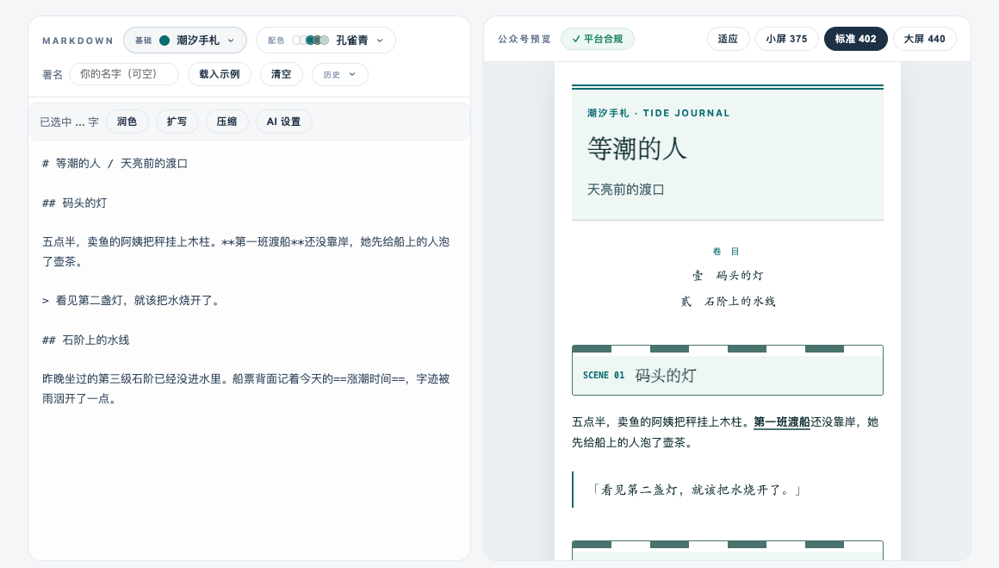

# YI TUO HUB STUDIO · 公众号排版工坊

把 Markdown 原稿排成适合微信公众号的文章。你可以在浏览器里选主题、按手机宽度预览，再把标题、引文、表格和正文一起复制到公众号后台。日常排版无需注册或填写 API 密钥。

[打开排版工坊](https://studio.yituohub.com/studio.html) · [AI 文章创作](https://studio.yituohub.com/create.html) · [生图工作台](https://studio.yituohub.com/gen/)



## 排第一篇文章

1. 把文章粘贴到左侧 **Markdown** 编辑区。从 Word、飞书或网页复制的富文本也可以直接粘贴，工坊会把它转成 Markdown。
2. 打开 **基础排版** 选择主题。在右侧切换 **小屏 375**、**标准 402** 或 **大屏 440**，查看长标题、段落和图片在不同宽度下的效果。
3. 点击 **复制到公众号**，在公众号后台的图文正文区粘贴。发布前用微信预览一次，尤其是带动效或外链图片的文章。

想试试上图的效果，可以选择 **潮汐手札**，粘贴这段原稿。

```markdown
# 等潮的人 / 天亮前的渡口

## 码头的灯

五点半，卖鱼的阿姨把秤挂上木柱。**第一班渡船**还没靠岸，她先给船上的人泡了壶茶。

> 看见第二盏灯，就该把水烧开了。

## 石阶上的水线

昨晚坐过的第三级石阶已经没进水里。船票背面记着今天的==涨潮时间==，字迹被雨洇开了一点。
```

## 主题与配色

工坊有 **21 套基础排版**。同一篇原稿可以随时切换主题，也可以在「配色」里调整底色、文字和强调色。

| 分组 | 可选主题 |
| --- | --- |
| 静态创意 · 5 套 | 潮汐手札、水墨长卷、复古号外、像素游戏机、胶片影志 |
| 分级视觉 · 16 套 | 墨红社论、黑金刊读、松烟刊读、珊瑚杂志、瑞士信号、柑橘报告、蓝图网格、稻纸朱砂、植物手记、柔和陶土、深海终端、雾蓝研究、紫灰工作室、新粗野、暗夜编辑、档案棕褐 |

**潮汐手札**默认用孔雀青，双线刊头下是带分镜编号的章节，引用用一条细竖线标出。它也提供潮蓝和海松两款配色。

在「视觉」菜单里，L1 是全库共用的黑白极简版。L2、L3 和 L4 分别提供静态简约版、装饰标题栏和完整主题场景。L5 为标题加入动效，L6 将动效延伸到章节装饰，两档都可以切回静态版。共用的 L1 加上 16 套主题各自的 L2 至 L6，共有 **81 种分级组合**，配有 **79 组动静态组件**。

## 草稿、导出与配图

- 在本浏览器重新打开工坊，可继续编辑自动保存的草稿。「历史」保留最近 20 次复制或下载 HTML 时的原稿和主题设置。
- **下载 HTML** 可以留存带样式的正文。**导出长图** 将当前预览保存为 PNG。「卡片」可导出公众号封面和带二维码的分享卡。
- 在 AI 创作页可以粘贴截图、拖入图片或选择文件。图片可直接嵌入文章，也可以上传到自己配置的图床。

## AI 写作与润色

在 AI 文章创作页填写自己的 OpenAI 兼容 API 密钥，载入模型后输入选题。可以选择文章类型、篇幅或自定义写作要求。生成的 Markdown 可以直接修改，点击「去排版」即可带入工坊。在工坊里选中一段原文，还可以单独润色、扩写或压缩。

写作和润色共用 API 设置，默认地址为 `https://www.yituohub.si/`。密钥保存在当前浏览器，请求直接发往所选服务。需要生成配图时，可使用独立部署的生图工作台，支持文生图和参考图改图。[生图工作台源码](https://github.com/yan9651688/yituo-img-studio)

## 本地运行与开发

从仓库根目录启动一个静态 HTTP 服务即可运行工坊。

```bash
git clone https://github.com/yan9651688/yituo-hub-studio.git
cd yituo-hub-studio
python3 -m http.server 8123 --bind 127.0.0.1
```

启动后可在浏览器打开这两个入口。[本地排版工坊](http://127.0.0.1:8123/studio.html) · [本地 AI 创作页](http://127.0.0.1:8123/create.html)

开发时可沿用仓库 CI 的 Node.js 22，最低为 22.13。安装测试依赖后运行检查。

```bash
npm ci
npm run check
```

修改导出功能后，可用 Chrome 或 Chromium 运行 `npm run qa:long-image-export`，验证 PNG 下载和尺寸。新增主题时，可参考「潮汐手札」在主题选择器、配色和正文渲染三处的实现。[主题注册](themes-data.js) · [配色与视觉等级](original-visuals-data.js) · [正文渲染](original-visuals.js)

也可以在仓库根目录用 Docker 启动工坊，同样通过本机的 8123 端口访问。

```bash
docker build -t yituo-hub-studio .
docker run --rm -p 127.0.0.1:8123:80 yituo-hub-studio
```

部署到已有的 Nginx 服务器时，可通过 SSH 和 rsync 同步静态文件。新增站点资源时，请一并更新部署清单。[部署脚本](deploy.sh) · [部署清单](deploy-files.txt)

## 赞助

[](https://www.yituohub.si/)

感谢 **易拓 AI** 赞助本项目。工坊默认连接其 API 服务，用于文章创作与润色。[易拓 AI 中转站](https://www.yituohub.si/)

## 作者与许可

排版工坊由颜和蓝梦共同打造。

<table>
<tr>
<td align="center"><br><a href="https://github.com/yan9651688"><strong>颜</strong></a><br>排版引擎与产品体验</td>
<td align="center"><br><a href="https://github.com/lanmengSakura"><strong>蓝梦</strong></a><br>原创视觉与动效组件</td>
</tr>
</table>

项目采用 AGPL-3.0-or-later 许可。动效组件版权归蓝梦所有，首页雪山摄影来自 Pexels。[项目许可](LICENSE) · [版权声明](NOTICE) · [动效组件授权](motion/AUTHORIZATION.md)

欢迎反馈排版问题或提交新主题。[提交 Issue](https://github.com/yan9651688/yituo-hub-studio/issues) · [姊妹项目 NEON ARCADE](https://game.yituohub.com/)
